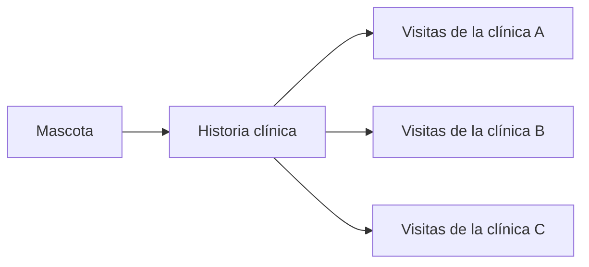
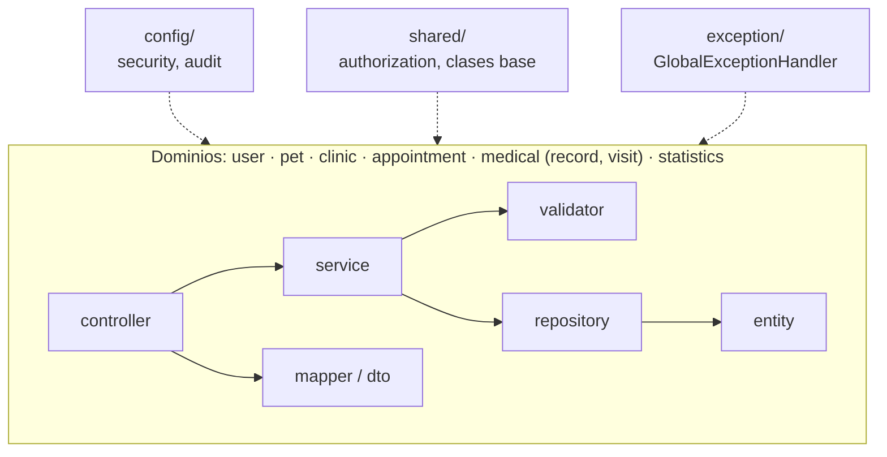

# PSyGCV — Historias clínicas veterinarias unificadas

Una historia clínica por mascota, compartida por todas las clínicas de la plataforma.

[English](README.md) | [Español](README.es.md)

[](https://github.com/guardiarene/unified-vet-records/actions/workflows/ci.yml)
[](https://github.com/guardiarene/unified-vet-records/actions/workflows/github-code-scanning/codeql)


PSyGCV es una aplicación web para clínicas veterinarias, desarrollada con Spring Boot y Thymeleaf.
Abarca mascotas, turnos, personal de las clínicas e historias clínicas, con acceso diferenciado
por rol.

---

## El problema

Cuando una mascota se atiende en más de una clínica veterinaria, su historia clínica queda
repartida: cada clínica guarda sus propias notas y ve solo una parte. Las alergias, enfermedades
previas, tratamientos y vacunas registrados en otro lugar son desconocidos para el veterinario que
tiene a la mascota delante.

---

## Historias clínicas unificadas

Cada mascota tiene exactamente una historia clínica en la plataforma. Las clínicas no guardan
copias separadas: cada clínica que atiende a la mascota agrega sus visitas a la misma historia.

- **Una historia por mascota.** La relación entre mascota e historia es uno a uno, respaldada por
  una clave única, y el servicio rechaza crear una segunda historia para una mascota que ya tiene
  una.
- **Compartida entre clínicas.** Un veterinario agrega visitas a la historia de una mascota cuando
  la mascota tiene un turno en su clínica. Las visitas de distintas clínicas se acumulan en la
  misma historia, ordenadas por fecha, de la más reciente a la más antigua.
- **Contenido de cada visita.** Cada visita registra la anamnesis, el examen clínico, los
  diagnósticos, los tratamientos y las vacunas, junto con el veterinario que la realizó.
- **Anamnesis vigente.** La historia muestra una anamnesis consolidada a partir de sus visitas:
  para cada campo (alergias, enfermedades previas, cirugías, medicación actual, dieta, estado
  reproductivo y las fechas de la última desparasitación, el último celo y el último parto) toma
  el valor registrado más reciente.



### Acceso: continuidad clínica frente a privacidad

Compartir una historia entre clínicas implica equilibrar la privacidad del dueño con la
continuidad clínica. La regla vincula el acceso a una relación de atención concreta, en lugar de
abrir todas las historias a todas las clínicas:

| Rol           | Acceso                                                                                                                                                                         |
|---------------|--------------------------------------------------------------------------------------------------------------------------------------------------------------------------------|
| Veterinario   | La historia completa, incluidas las visitas de otras clínicas, cuando la mascota tiene un turno en la clínica del veterinario. Cuenta cualquier turno, incluso uno cancelado. |
| Cliente       | Consulta las historias de sus propias mascotas.                                                                                                                                |
| Recepcionista | Sin acceso a historias clínicas ni a visitas.                                                                                                                                  |

La unificación ocurre entre las clínicas registradas en la plataforma. Las historias no se
intercambian con sistemas externos.

Las reglas de acceso están implementadas en
[`ResourceAuthorizationService`](src/main/java/tfg/psygcv/shared/authorization/ResourceAuthorizationService.java)
y la lógica de las historias en
[`MedicalRecordServiceImpl`](src/main/java/tfg/psygcv/medical/record/service/MedicalRecordServiceImpl.java).

---

## Funcionalidades por rol

Tras iniciar sesión, cada usuario es redirigido al dashboard de su rol.

| Rol           | Funcionalidades                                                                                                                                         |
|---------------|---------------------------------------------------------------------------------------------------------------------------------------------------------|
| Cliente       | Registro, gestión de mascotas, búsqueda de clínicas, solicitud y cancelación de turnos, consulta de las historias clínicas de sus mascotas.            |
| Veterinario   | Registro de la clínica, alta de personal (veterinarios y recepcionistas), catálogo de servicios médicos, historias clínicas y visitas, reportes clínicos. |
| Recepcionista | Agenda y reprogramación de turnos, actualización del estado de los turnos, reportes de turnos.                                                         |
| Administrador | Gestión de usuarios.                                                                                                                                    |

---

## Aspectos técnicos destacados

- **Autorización a nivel de recurso.** Las interfaces de servicio declaran comprobaciones
  `@PreAuthorize` que delegan en
  [`ResourceAuthorizationService`](src/main/java/tfg/psygcv/shared/authorization/ResourceAuthorizationService.java)
  (por ejemplo,
  [`MedicalRecordService`](src/main/java/tfg/psygcv/medical/record/service/MedicalRecordService.java)).
  Un recurso que pertenece a otro usuario se rechaza con el mismo 403 que uno que no existe, de
  modo que su existencia queda oculta.
- **Invariantes de dominio en la capa de servicio.** Las relaciones que llegan como IDs desde un
  formulario, como una mascota y su dueño o un servicio médico y su clínica, se verifican en el
  servicio, no solo en el DTO (por ejemplo,
  [`AppointmentValidator`](src/main/java/tfg/psygcv/appointment/service/AppointmentValidator.java)).
- **Manejo global de errores.**
  [`GlobalExceptionHandler`](src/main/java/tfg/psygcv/exception/GlobalExceptionHandler.java)
  traduce las excepciones de dominio al status HTTP correcto (400, 403, 404, 500) y registra los
  errores inesperados con un ID de correlación, sin exponer stack traces.
- **Soft delete transparente.**
  [`AuditableEntity`](src/main/java/tfg/psygcv/shared/entity/AuditableEntity.java) lleva
  `@SQLRestriction("active = true")`, de modo que las filas inactivas quedan fuera de todas las
  consultas.
- **Capa de DTOs y mappers.** Los controllers nunca exponen entidades JPA: los DTOs de request y
  de response se convierten con mappers estáticos y explícitos, y las operaciones complejas llegan
  al servicio como objetos command.
- **Perfiles por entorno.** `dev`, `test` y `prod` aíslan la configuración de base de datos y de
  logging; las credenciales locales quedan fuera del repositorio.
- **Pipeline de CI.** [`ci.yml`](.github/workflows/ci.yml) ejecuta el build, Dependency Review y
  la validación de Conventional Commits en los pull requests, con cada Action fijada a un SHA de
  commit. CodeQL corre mediante la configuración por defecto de GitHub, y
  [Dependabot](.github/dependabot.yml) actualiza las dependencias de Maven y las Actions con un
  período de cooldown.
- **Convenciones.** Los estándares del proyecto están documentados en
  [`CONVENTIONS.md`](CONVENTIONS.md).

---

## Arquitectura

El código se organiza por dominio (vertical slices), y cada dominio contiene sus propias capas. La
infraestructura transversal vive en `config/`, `shared/` y `exception/`.



| Perfil  | Base de datos | Propósito                                                                                   |
|---------|---------------|---------------------------------------------------------------------------------------------|
| `dev`   | MySQL         | Desarrollo local. Importa las credenciales de `application-local.yaml`                      |
| `test`  | H2            | Base de datos en memoria para los tests y la CI                                             |
| `prod`  | MySQL         | Producción. Credenciales desde variables de entorno; el esquema se valida                   |
| `debug` | —             | Opcional, solo para uso local. Registra las sentencias SQL y sus parámetros; usar `dev,debug` |

---

## Primeros pasos

### Requisitos

- JDK 25
- MySQL 8

No hace falta instalar Maven: el proyecto incluye el Maven Wrapper.

### Pasos

1. **Clonar el repositorio:**
   ```bash
   git clone https://github.com/guardiarene/unified-vet-records.git
   cd unified-vet-records
   ```

2. **Crear la base de datos:**
   ```sql
   CREATE DATABASE psygcv_dev;
   ```

3. **Configurar las credenciales** en un archivo `application-local.yaml` en la raíz del proyecto
   (no versionado; lo importa el perfil `dev`):
   ```yaml
   spring:
     datasource:
       url: jdbc:mysql://localhost:3306/psygcv_dev
       username: tu_usuario
       password: tu_contraseña
   ```
   Como alternativa, definir las variables de entorno `DB_URL`, `DB_USERNAME` y `DB_PASSWORD`. Si
   existe `application-local.yaml`, sus valores tienen prioridad.

4. **Compilar y verificar:**
   ```bash
   ./mvnw clean verify
   ```

5. **Ejecutar la aplicación** con el perfil `dev`:
   ```bash
   ./mvnw spring-boot:run -Dspring-boot.run.profiles=dev
   ```
   Para registrar las sentencias SQL y los valores de sus parámetros, sumar el perfil opcional
   `debug` (solo para uso local):
   ```bash
   ./mvnw spring-boot:run -Dspring-boot.run.profiles=dev,debug
   ```

La aplicación queda disponible en [http://localhost:8080](http://localhost:8080).

**Windows:** usar `.\mvnw.cmd` en lugar de `./mvnw`. En PowerShell, poner entre comillas cada
argumento `-D`, porque PowerShell divide los argumentos sin comillas en el primer punto:

```powershell
.\mvnw.cmd spring-boot:run "-Dspring-boot.run.profiles=dev"
```

---

## Roadmap

**Próximos pasos**

- Tests automatizados
- Migraciones de base de datos (Flyway)
- Contenerización (Docker y Docker Compose)
- Un pipeline de entrega continua
- Despliegue en la nube con contenedores

**Del diseño original**

- Bloqueo de cuentas tras intentos fallidos de inicio de sesión
- Una política de contraseñas completa
- Expiración de contraseñas
- Autenticación multifactor

**Largo plazo**

- Un frontend en React que consuma una API REST

---

El proyecto comenzó como Trabajo Final de Grado y sigue evolucionando como proyecto de portfolio,
aplicando prácticas de producción.
