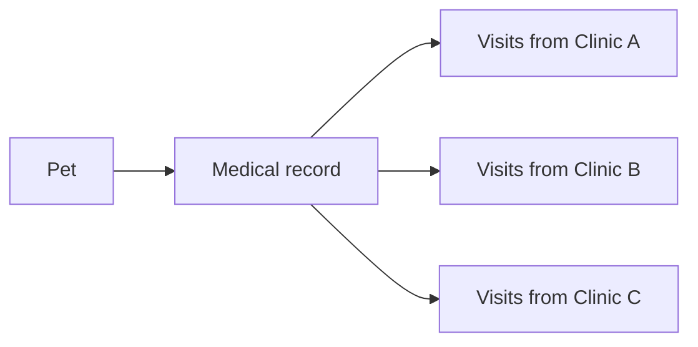
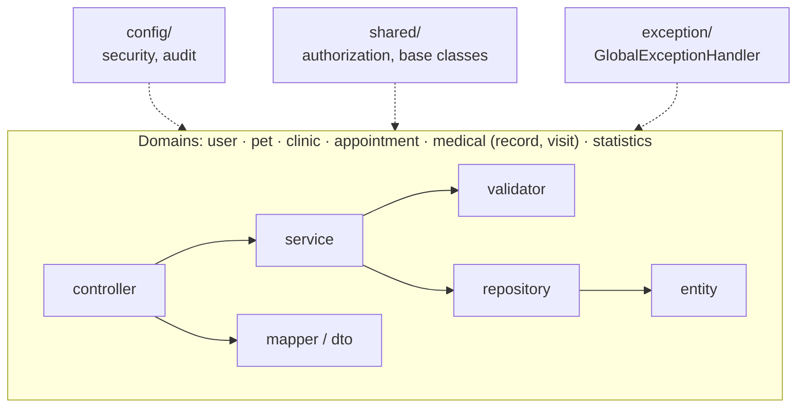

# PSyGCV — Unified Veterinary Medical Records

One medical record per pet, shared by every clinic on the platform.

[English](README.md) | [Español](README.es.md)

[](https://github.com/guardiarene/unified-vet-records/actions/workflows/ci.yml)
[](https://github.com/guardiarene/unified-vet-records/actions/workflows/github-code-scanning/codeql)


PSyGCV is a web application for veterinary clinics, built with Spring Boot and Thymeleaf. It
covers pets, appointments, clinic staff and clinical records, with role-based access.

---

## The problem

When a pet is treated at more than one veterinary clinic, its clinical history ends up scattered:
each clinic keeps its own notes and sees only part of the picture. Allergies, previous diseases,
treatments and vaccines recorded elsewhere are unknown to the veterinarian in front of the pet.

---

## Unified medical records

Each pet has exactly one medical record on the platform. Clinics do not keep separate copies:
every clinic that treats the pet adds its visits to the same record.

- **One record per pet.** The pet–record relationship is one-to-one, backed by a unique key, and
  the service rejects creating a second record for a pet that already has one.
- **Shared across clinics.** A veterinarian adds visits to a pet's record when the pet has an
  appointment at their clinic. Visits from different clinics accumulate in the same record,
  ordered by date, most recent first.
- **Visit content.** Each visit records the anamnesis, clinical exam, diagnoses, treatments and
  vaccines, together with the veterinarian who performed it.
- **Current anamnesis.** The record shows a consolidated anamnesis built from its visits: for each
  field (allergies, previous diseases, surgeries, current medication, diet, reproductive status
  and the last deworming, heat and birth dates) it takes the most recent value recorded.



### Access: continuity of care versus privacy

Sharing a record across clinics trades the owner's privacy against clinical continuity. The rule
ties access to a concrete care relationship instead of opening every record to every clinic:

| Role         | Access                                                                                                                                                                  |
|--------------|-------------------------------------------------------------------------------------------------------------------------------------------------------------------------|
| Veterinarian | The full record, including visits from other clinics, when the pet has an appointment at the veterinarian's clinic. Any appointment counts, including a cancelled one. |
| Customer     | Views the records of their own pets.                                                                                                                                    |
| Receptionist | No access to medical records or visits.                                                                                                                                 |

Unification happens among the clinics registered on the platform. Records are not exchanged with
external systems.

The access rules are implemented in
[`ResourceAuthorizationService`](src/main/java/tfg/psygcv/shared/authorization/ResourceAuthorizationService.java)
and the record logic in
[`MedicalRecordServiceImpl`](src/main/java/tfg/psygcv/medical/record/service/MedicalRecordServiceImpl.java).

---

## Features by role

After login, each user is redirected to the dashboard for their role.

| Role          | Features                                                                                                                                              |
|---------------|-------------------------------------------------------------------------------------------------------------------------------------------------------|
| Customer      | Registration, pet management, clinic search, requesting and cancelling appointments, viewing their pets' medical records.                           |
| Veterinarian  | Clinic registration, staff onboarding (veterinarians and receptionists), medical service catalog, medical records and visits, clinical reports.      |
| Receptionist  | Appointment scheduling and rescheduling, appointment status updates, appointment reports.                                                            |
| Administrator | User management.                                                                                                                                      |

---

## Engineering highlights

- **Resource-level authorization.** Service interfaces declare `@PreAuthorize` checks that
  delegate to
  [`ResourceAuthorizationService`](src/main/java/tfg/psygcv/shared/authorization/ResourceAuthorizationService.java)
  (for example,
  [`MedicalRecordService`](src/main/java/tfg/psygcv/medical/record/service/MedicalRecordService.java)).
  A resource that belongs to someone else is rejected with the same 403 as one that does not
  exist, so its existence stays hidden.
- **Domain invariants in the service layer.** Relationships that arrive as IDs from a form, such
  as a pet and its owner or a medical service and its clinic, are verified in the service, not
  only in the DTO (for example,
  [`AppointmentValidator`](src/main/java/tfg/psygcv/appointment/service/AppointmentValidator.java)).
- **Global error handling.**
  [`GlobalExceptionHandler`](src/main/java/tfg/psygcv/exception/GlobalExceptionHandler.java) maps
  domain exceptions to the correct HTTP status (400, 403, 404, 500) and logs unexpected errors
  with a correlation ID, without exposing stack traces.
- **Transparent soft delete.**
  [`AuditableEntity`](src/main/java/tfg/psygcv/shared/entity/AuditableEntity.java) carries
  `@SQLRestriction("active = true")`, so inactive rows are filtered out of every query.
- **DTO and mapper layer.** Controllers never expose JPA entities: request and response DTOs are
  converted by explicit, static mappers, and complex operations reach the service as command
  objects.
- **Per-environment profiles.** `dev`, `test` and `prod` isolate database and logging
  configuration; local credentials live outside the repository.
- **CI pipeline.** [`ci.yml`](.github/workflows/ci.yml) runs the build, Dependency Review and
  Conventional Commits validation on pull requests, with every Action pinned to a commit SHA.
  CodeQL runs through GitHub's default setup, and
  [Dependabot](.github/dependabot.yml) updates Maven dependencies and Actions with a cooldown
  period.
- **Conventions.** Project standards are documented in [`CONVENTIONS.md`](CONVENTIONS.md).

---

## Architecture

The code is organized by domain (vertical slices), and each domain owns its layers. Cross-cutting
infrastructure lives in `config/`, `shared/` and `exception/`.



| Profile | Database | Purpose                                                                        |
|---------|----------|--------------------------------------------------------------------------------|
| `dev`   | MySQL    | Local development. Imports credentials from `application-local.yaml`           |
| `test`  | H2       | In-memory database for test runs and CI                                        |
| `prod`  | MySQL    | Production. Credentials from environment variables; the schema is validated   |
| `debug` | —        | Optional, local only. Logs SQL statements and bound parameters; use `dev,debug` |

---

## Getting started

### Requirements

- JDK 25
- MySQL 8

Maven is not required: the project includes the Maven Wrapper.

### Steps

1. **Clone the repository:**
   ```bash
   git clone https://github.com/guardiarene/unified-vet-records.git
   cd unified-vet-records
   ```

2. **Create the database:**
   ```sql
   CREATE DATABASE psygcv_dev;
   ```

3. **Configure the credentials** in an `application-local.yaml` file at the project root (not
   versioned; imported by the `dev` profile):
   ```yaml
   spring:
     datasource:
       url: jdbc:mysql://localhost:3306/psygcv_dev
       username: your_user
       password: your_password
   ```
   Alternatively, set the `DB_URL`, `DB_USERNAME` and `DB_PASSWORD` environment variables. If
   `application-local.yaml` exists, its values take precedence.

4. **Build and verify:**
   ```bash
   ./mvnw clean verify
   ```

5. **Run the application** with the `dev` profile:
   ```bash
   ./mvnw spring-boot:run -Dspring-boot.run.profiles=dev
   ```
   To log SQL statements and their parameter values, add the optional `debug` profile (local use
   only):
   ```bash
   ./mvnw spring-boot:run -Dspring-boot.run.profiles=dev,debug
   ```

The application is available at [http://localhost:8080](http://localhost:8080).

**Windows:** use `.\mvnw.cmd` instead of `./mvnw`. In PowerShell, quote every `-D` argument,
because PowerShell splits unquoted arguments at the first dot:

```powershell
.\mvnw.cmd spring-boot:run "-Dspring-boot.run.profiles=dev"
```

---

## Roadmap

**Next**

- Automated tests
- Database migrations (Flyway)
- Containerization (Docker and Docker Compose)
- A continuous delivery pipeline
- Cloud deployment with containers

**From the original design**

- Account lockout after failed login attempts
- A complete password policy
- Password expiration
- Multi-factor authentication

**Long term**

- A React frontend consuming a REST API

---

The project started as a final degree project and continues to evolve as a portfolio project,
applying production practices.
